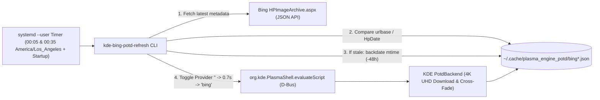

# KDE Bing Wallpaper Timezone Sync (`kde-bing-potd-refresh`)

[](https://github.com/russellmilliner/kde-bing-potd-refresh/releases/tag/v0.1.1)
[](https://github.com/russellmilliner/kde-bing-potd-refresh/releases/download/v0.1.1/kde-bing-potd-refresh-0.1.1-1-any.pkg.tar.zst)
[](https://kde.org/plasma-desktop/)
[](LICENSE)
[](https://ko-fi.com/russellmilliner)

> **Lightweight Python CLI and DST-aware `systemd --user` timer that fixes KDE Plasma 6's 1-day-behind Bing Picture of the Day wallpaper lag for users east of Pacific Time.**

---

## Why This Exists (The 3-Hour Timezone Lag)

KDE Plasma's built-in Picture of the Day plugin (`org.kde.potd` with `Provider=bing`) schedules a single daily update at **00:01 local time**. However, Microsoft anchors the `en-US` Bing Picture of the Day feed (`HPImageArchive.aspx`) to **00:00 Pacific Time (`America/Los_Angeles`)** (`08:00 UTC` / `03:00` Eastern Time year-round).

For anyone in Central, Mountain, or Eastern time zones:
1. KDE queries Bing at `00:01` local time, before Bing has rotated to the new day's image.
2. Bing returns **yesterday's** image, and KDE writes it to `~/.cache/plasma_engine_potd/bing:3840:2160` with **today's** file modification timestamp.
3. KDE checks `QDateTime::daysTo()` against that cache `mtime`, sees it already ran "today," and skips fetching until the next local midnight—causing holiday and daily wallpapers to show up **a full day behind Windows**.

`kde-bing-potd-refresh` solves this cleanly without replacing KDE's native `org.kde.potd` plugin, preserving smooth cross-fade transitions and the desktop right-click **"About '…'"** and **"Open Wallpaper Image"** menu items.

---

## Architecture



---

## Installation

### 1. Arch Linux / EndeavourOS (`pacman` `.pkg.tar.zst`)

Build from source with `makepkg` or install the release package from [GitHub Releases](https://github.com/russellmilliner/kde-bing-potd-refresh/releases):

```bash
# Option A: Install prebuilt release package
sudo pacman -U kde-bing-potd-refresh-0.1.1-1-any.pkg.tar.zst
systemctl --user enable --now kde-bing-potd-refresh.timer

# Option B: Build and install locally via ./scripts/build-packages.sh
./scripts/build-packages.sh
sudo pacman -U dist/kde-bing-potd-refresh-0.1.1-1-any.pkg.tar.zst
systemctl --user enable --now kde-bing-potd-refresh.timer
```

### 2. Python Package (`uv` / `pipx` / `pip`)

Zero external Python dependencies (uses the Python standard library):

```bash
uv tool install .
kde-bing-potd-refresh --install-timer
```

Or with `pipx` / `pip`:

```bash
pip install --user .
kde-bing-potd-refresh --install-timer
```

### 3. Zero-Dependency User Installer (Any KDE Plasma 6 Distro)

Installs the module to `~/.local/share/kde-bing-potd-refresh`, wrapper to `~/.local/bin/kde-bing-potd-refresh`, and user units to `~/.config/systemd/user/`:

```bash
./scripts/install.sh
```

To uninstall completely:

```bash
./scripts/uninstall.sh
```

---

## CLI Reference & Environment Variables

| Option / Env Var | Default | Description |
| :--- | :--- | :--- |
| *(no arguments)* | — | Idempotent sync: exits immediately if local cache matches Bing; otherwise backdates stale cache and refreshes `org.kde.potd` |
| `-s`, `--status`, `--check` | `false` | Inspect live Bing metadata, local `bing*.json` cache entries, and `systemd --user` timer status without modifying files |
| `-f`, `--force` | `false` | Force cache backdating and `plasmashell` re-fetch even when the cache already matches today's image |
| `--json` | `false` | Emit machine-readable JSON output for `--status` or sync runs |
| `--market <MKT>` / `BING_POTD_MARKET` | `""` (auto) | Optional Bing market override (e.g. `en-US`, `en-GB`, `de-DE`) appended as `&mkt=<MKT>` |
| `--cache-dir <PATH>` | `$XDG_CACHE_HOME/plasma_engine_potd` | Override KDE Plasma POTD cache directory |
| `--install-timer` | `false` | Write `kde-bing-potd-refresh.{service,timer}` into `~/.config/systemd/user/` and enable the timer |
| `--uninstall-timer` | `false` | Disable and remove the `systemd --user` service and timer units |
| `-V`, `--version` | — | Print installed version (`kde-bing-potd-refresh 0.1.1`) |

### Common Commands

```bash
# Check live Bing vs local cache sync status
kde-bing-potd-refresh --status

# Machine-readable JSON status check
kde-bing-potd-refresh --status --json

# Force an immediate refresh on Primary Screen
kde-bing-potd-refresh --force

# Check next scheduled Pacific-anchored timer elapse and recent logs
systemctl --user list-timers kde-bing-potd-refresh.timer --no-pager
journalctl --user -u kde-bing-potd-refresh.service -n 20 --no-pager
```

---

## Additional Documentation

- [Architecture & KDE Plasma Internals](docs/ARCHITECTURE.md)
- [Troubleshooting & Multi-Resolution Cache Notes](docs/TROUBLESHOOTING.md)
- [Changelog](CHANGELOG.md)

---

## License & Copyright

Licensed under the [Apache License, Version 2.0](LICENSE). Copyright © 2026 [Russell Milliner](https://github.com/russellmilliner).
